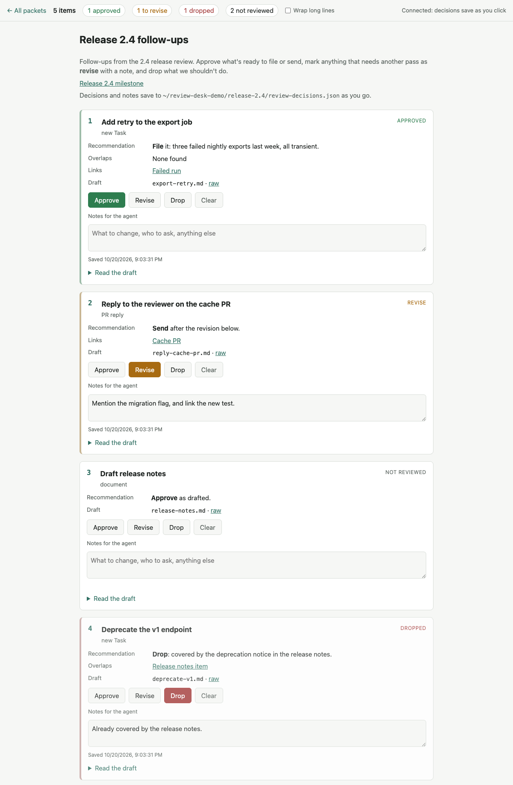
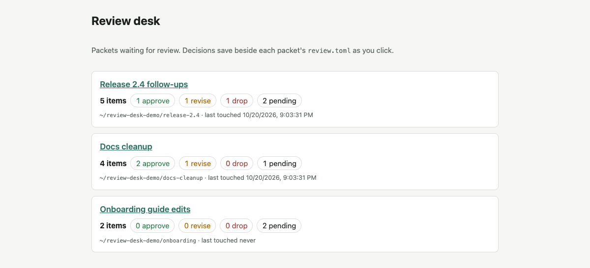
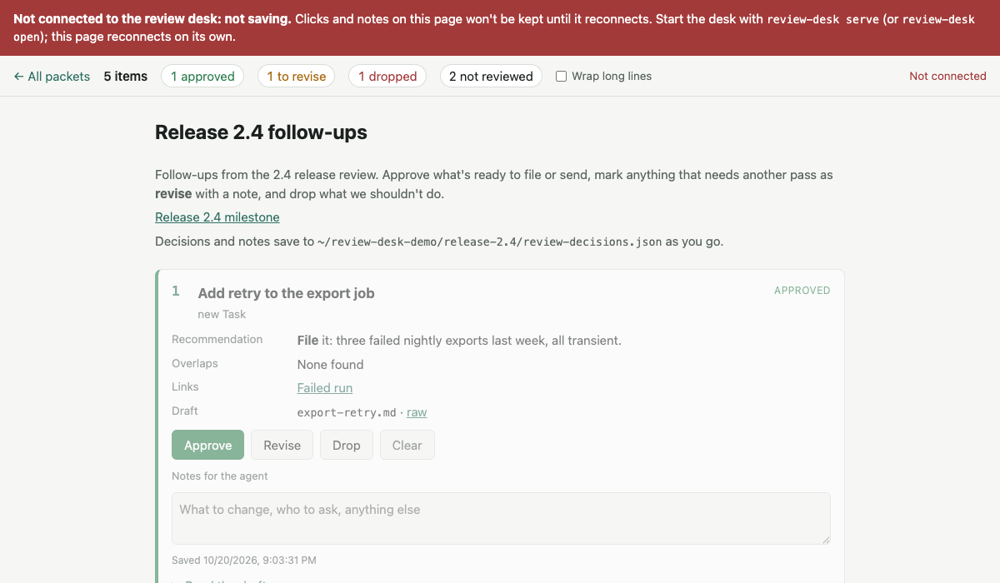
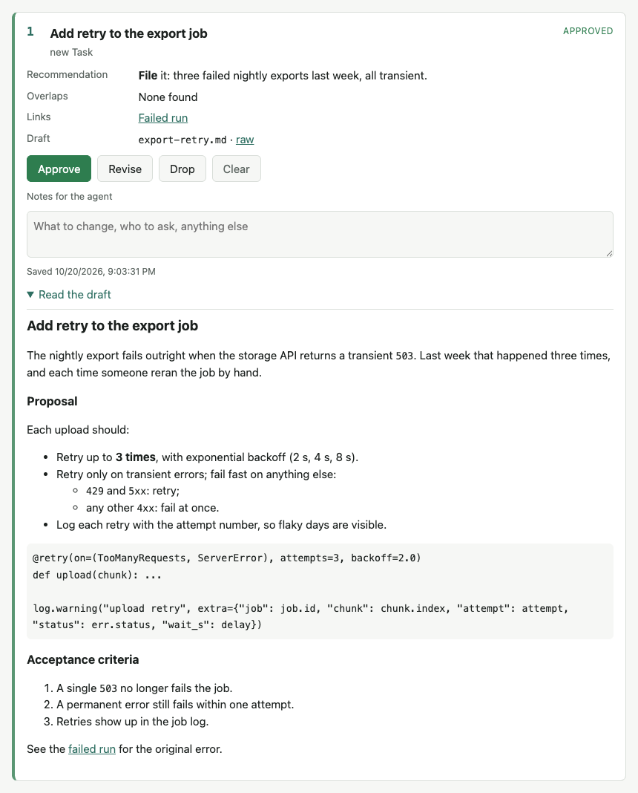

# review-desk

An asynchronous approval queue for agent drafts, fully local.

Coding agents produce things a human has to approve: ticket drafts, PR replies, plans, notes. Approving them inside a
chat that jumps between topics is lossy. The desk takes the review out of the conversation:

- an agent groups its drafts into a **review packet** (a directory with a `review.toml` manifest);
- you review the packet in a browser at your own pace, marking each item **approve**, **revise** or **drop**, with a note;
- every click and note saves to disk at once (`review-decisions.json`, beside the manifest);
- any agent, in any later session, reads the decisions back with `review-desk status` and acts on them.

The review lifecycle is decoupled from the rest of the conversation.

<picture>
  <source media="(prefers-color-scheme: dark)" srcset="docs/screenshots/packet-dark.png">
  
</picture>

*A packet page, in your system's light or dark theme ([light](docs/screenshots/packet-light.png),
[dark](docs/screenshots/packet-dark.png)). The bar keeps the tally; each card holds one decision and its note.*

Nothing leaves the machine. The server binds 127.0.0.1 only, and the one runtime dependency is `markdown-it-py`.

## Install

Needs [uv](https://docs.astral.sh/uv/) and Python 3.11 or later.

```sh
git clone https://github.com/ddl-h-morgan/review-desk.git review-desk
cd review-desk && uv sync
ln -s "$PWD/bin/review-desk" ~/.local/bin/review-desk   # or: alias review-desk="$PWD/bin/review-desk"
```

`bin/review-desk` runs the CLI from the checkout (`uv run --offline`), so a `git pull` is all an update needs. The
examples below assume `review-desk` is on your `PATH`.

## Quick start

```sh
review-desk new ~/work/drafts --title "Release follow-ups"   # scaffold review.toml, then edit it
review-desk add ~/work/drafts
review-desk open ~/work/drafts                               # starts the desk if needed, opens the page
review-desk status ~/work/drafts                             # later, from any session
```

The desk serves every registered packet from one process, on port **8791** by default (`--port`, or `$REVIEW_DESK_PORT`).
The index at <http://127.0.0.1:8791/> lists packets with approve, revise, drop and pending counts, and when each was last
touched. Each packet page is rendered from its manifest and draft files on every request, so an edited draft shows on reload
with no rebuild.



*The index: every registered packet, with its counts.*

The page checks the desk every few seconds. If the desk stops, a red banner says nothing is being saved and the controls
are disabled until it's back, so no click looks saved that wasn't.



*The desk stopped while the page was open.*

## Browser

`review-desk open` picks the browser from `--browser NAME`, else `$REVIEW_DESK_BROWSER`, else the system default:

- **macOS:** a named browser is an application name, opened in a new window:
  `open -na "<NAME>" --args --new-window <url>`. Unset, it runs `open <url>` (the default browser).
- **Elsewhere:** Python's `webbrowser` (`webbrowser.get(NAME)` when one is named).

For example, to always get a new window of Brave on macOS, put this in your shell profile:

```sh
export REVIEW_DESK_BROWSER="Brave Browser"
```

`--no-browser` skips the browser and the desk start, and only prints the URL.

## Commands

All commands are non-interactive and exit 0 on success, 1 on error (message on stderr).

| Command | What it does |
|---|---|
| `new <dir> [--title T]` | Writes a commented `review.toml` (and `example-draft.md`) into `<dir>`. Refuses to overwrite. |
| `add <dir>` | Validates the manifest and registers the packet by absolute path. Idempotent. |
| `remove <dir>` | Unregisters the packet. Its files, decisions included, are untouched. |
| `list [--json]` | Registered packets, with counts and last-touched time. |
| `status <dir> [--json]` | Agent-readable summary: counts, each item's decision and note, `undecided` ids, `orphans` (decided ids no longer in the manifest). Reads the files directly, so the desk needn't be running. |
| `status [--json]` | Without a dir: one line per registered packet, plus how many have pending items. |
| `serve [--port N] [--background]` | Runs the desk in the foreground, or with `--background` starts it detached (if not already up), prints the URL and exits. Log: `~/.local/state/review-desk/desk-<port>.log`. |
| `open [<dir>] [--port N] [--browser NAME] [--no-browser]` | Opens the index, or a packet, in a browser (see [Browser](#browser)), starting the desk first if needed. Registers `<dir>` if it isn't yet. `--no-browser` only prints the URL. |

The registry lives at `~/.local/state/review-desk/packets.json` (`$REVIEW_DESK_STATE` overrides the directory).

## Packet format

A packet is any directory holding `review.toml`:

```toml
title = "Release follow-ups"            # required
intro = """                             # optional, markdown, shown above the cards
What this batch is and what to decide.
"""
links = [{label = "Issue 1234", url = "https://example.com/issues/1234"}]   # optional
appendix = """                          # optional, markdown, shown below the cards (evidence tables etc.)
"""

[[items]]
id = "fix-the-foo"                  # required, stable slug: [a-z0-9][a-z0-9-]{0,79}; decisions are keyed by it
title = "Fix the foo"                   # required (inline markdown)
kind = "new Task"                       # optional (inline markdown)
recommendation = "**File** it."         # optional (inline markdown)
file = "fix-the-foo.md"             # optional: .md/.markdown/.txt, relative to the packet, must stay inside it
links = ["https://example.com", {label = "PR #1", url = "https://github.com/o/r/pull/1"}]   # optional
[items.facts]                           # optional extra rows on the card: label = inline markdown
Overlaps = "[issue 1](https://example.com/issues/1)"
```

Each item becomes a card. The card shows the recommendation, facts and links; **Read the draft** expands the item's
file, rendered as GitHub-flavoured markdown (CommonMark, plus tables, strikethrough and bare-URL links), so a draft
looks as it will on GitHub: a list can follow a line of text directly, and two-space indents nest. Long code lines
scroll sideways; tick **Wrap long lines** in the top bar to wrap them instead (a per-browser preference, kept in
`localStorage`):



**Decisions** live beside the manifest in `review-decisions.json`:

```json
{"fix-the-foo": {"decision": "revise", "note": "shorter title", "updatedAt": "2026-10-20T18:55:27.184Z"}}
```

`decision` is `approve`, `revise`, `drop`, or `""` (cleared, counts as pending). This shape is a stable contract, so
existing decisions files keep working. Ids that leave the manifest keep their records and show up as `orphans` in `status`.

**Don't rename an item id once review has started**: the old decision becomes an orphan and the item shows as pending.

## Agent workflow

1. **Create the packet.** Put the drafts in one directory and write `review.toml` (`review-desk new <dir>` gives a
   template). One item per thing the reviewer must decide. Put your recommendation on the card, and anything that
   changes the decision (overlapping work, risks) in `facts`.
2. **`review-desk add <dir>`**, then **`review-desk open <dir>`**, and tell the reviewer it's waiting (the URL is
   printed). Don't ask for the decisions in chat; move on.
3. **Later, in any session: `review-desk status <dir> --json`.** Act only on what's there:
   - `approve`: do it (the click is the approval for that item, but follow your project's own rules for logging it);
   - `revise`: edit the draft per the `note`. The page re-renders it on reload. Say which items changed; they get re-decided;
   - `drop`: don't do it; leave the file;
   - `undecided`: leave it alone; it's still waiting.
4. Never write `review-decisions.json` yourself. Decisions are the reviewer's. (The desk's PUT API exists for the page.)

## Install the skill

`skills/review-desk/SKILL.md` is a [Claude Code skill](https://docs.claude.com/en/docs/claude-code/skills) that teaches an
agent the workflow above. Install it for all your projects, or for one:

```sh
ln -s "$PWD/skills/review-desk" ~/.claude/skills/review-desk          # every project (or cp -R)
ln -s "$PWD/skills/review-desk" /path/to/project/.claude/skills/review-desk   # one project
```

## Security

A local web server is reachable from every web page you open, so the desk treats the browser as hostile. Each rule has a
test in `tests/test_server.py`, and `bin/mutation-check` breaks each rule in turn to prove the tests catch it.

- Binds 127.0.0.1 only.
- Every request needs `Host` to be exactly `127.0.0.1:<port>` or `localhost:<port>`, which defeats DNS rebinding.
- Writes need `X-Review-Desk: 1` (a cross-origin form or no-cors fetch can't send a custom header), `Content-Type:
  application/json`, a same-origin `Origin` when one is sent, and no cross-site `Sec-Fetch-Site`.
- Only registered packets and item ids from the manifest are reachable. URL segments must be plain slugs (no decoding,
  no dots), and item files are served only through the manifest mapping, never by filename. The manifest rejects
  absolute paths, `..`, and symlinks that resolve outside the packet.
- Request bodies are capped at 64 KiB, notes at 20,000 characters.
- Untrusted text is escaped: markdown renders with raw HTML disabled, and only http(s), mailto and relative links (and image sources) survive.
  Pages also carry a strict CSP (`default-src 'none'`, script and style from the desk only), `nosniff`, `DENY` framing,
  and `no-referrer`.
- Writes merge one item at a time under a lock and replace the file atomically (temp file, fsync, rename). A corrupt
  decisions file is never overwritten.

Not covered: other processes running as your user can read and write the files directly. That's the same trust boundary
as the files themselves.

## Optional: run at login on macOS (example only)

`~/Library/LaunchAgents/local.review-desk.plist`, with the `/path/to/...` placeholders replaced by absolute paths (launchd doesn't expand `~`):

```xml
<?xml version="1.0" encoding="UTF-8"?>
<!DOCTYPE plist PUBLIC "-//Apple//DTD PLIST 1.0//EN" "http://www.apple.com/DTDs/PropertyList-1.0.dtd">
<plist version="1.0"><dict>
  <key>Label</key><string>local.review-desk</string>
  <key>ProgramArguments</key><array>
    <string>/path/to/review-desk/bin/review-desk</string><string>serve</string><string>--port</string><string>8791</string>
  </array>
  <key>EnvironmentVariables</key><dict><key>PATH</key><string>/opt/homebrew/bin:/usr/local/bin:/usr/bin:/bin</string></dict>
  <key>RunAtLoad</key><true/>
  <key>KeepAlive</key><true/>
  <key>StandardErrorPath</key><string>/path/to/home/.local/state/review-desk/launchd.log</string>
</dict></plist>
```

Load it with `launchctl bootstrap gui/$(id -u) ~/Library/LaunchAgents/local.review-desk.plist`.

## Development

`uv run --offline pytest -q` runs the tests; `bin/mutation-check` breaks each security and merge rule in turn and
checks the suite catches it. `CLAUDE.md` has the working notes. `docs/screenshots/make.py` regenerates the screenshots
from dummy packets on a scratch desk (port 8794); see its header for how to run it.

## License

Apache License 2.0. See [LICENSE](LICENSE).
